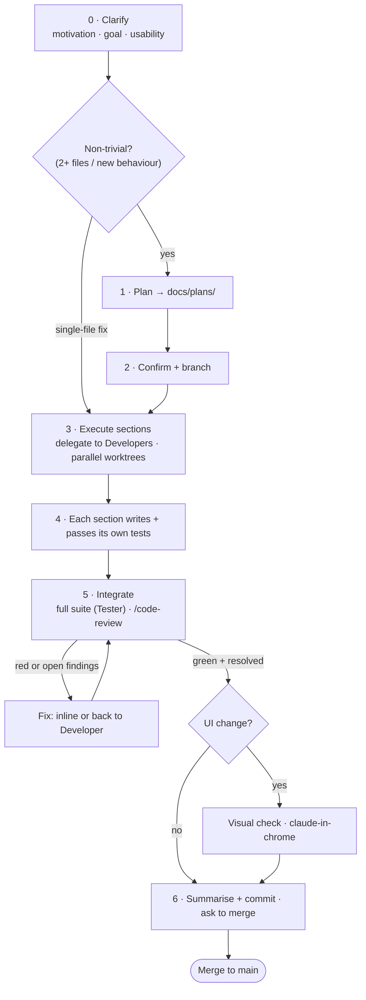

# Claude Code global config

Version-controlled copy of my global `~/.claude` config: `CLAUDE.md`, `settings.json`,
and the authored `skills/`, `commands/`, and `agents/`. Everything else in `~/.claude`
(session history, plugins, caches, credentials) is machine-local and git-ignored.

## What's tracked

| Path | What it is |
|------|------------|
| `CLAUDE.md` | Global instructions applied to every project |
| `settings.json` | Permissions, hooks, status line, enabled plugins, marketplaces, prefs |
| `commands/` | Custom slash commands — all `as-*` service helpers (see note below) |
| `agents/` | Custom sub-agent definitions |
| `statusline.sh` | Status line: optional machine-role badge + claude-hud (auto-located) |

The `commands/` are project-specific helpers for my `as_*` services — **not needed to install this
config**. If you're replicating the setup, ignore or delete them.

`skills/` is intentionally **not** tracked — it only holds auto-synced built-in skills
(they regenerate on their own) and local symlinks. To version an authored skill later,
add `!skills/<name>/**` to `.gitignore`.

Paths in `settings.json` use `$HOME` (not a hardcoded username) and call `node` via
`PATH`, so the file is portable across machines.

## Replicate onto a new machine

`~/.claude` already exists on any machine that has run Claude Code, so **don't `git clone`**
(it refuses a non-empty dir). Init in place and pull — git only touches tracked files, so
your local sessions, plugins, and credentials are never at risk:

```bash
cd ~/.claude
git init
git remote add origin <REPO_URL>
git fetch origin
git reset --hard origin/main   # overwrites ONLY tracked files; ignored junk untouched
```

To later pull updates on that machine: `git pull`. To keep a machine-specific tweak to a
tracked file without pushing it, commit it on a local branch or just don't `reset --hard`.

## External dependencies (not in this repo)

Referenced by `settings.json` or the `CLAUDE.md` workflow but living outside `~/.claude` — set
them up per machine or the hooks/status line/workflow will error:

- **`git`** — to pull this repo *and* for Claude Code to fetch the GitHub plugin marketplaces in
  `extraKnownMarketplaces` on startup.
- **`node` on `PATH`** — the claude-hud status line, the `typescript-lsp` plugin, and workflow tooling.
- **`gh` (GitHub CLI), authenticated** — the dev/release workflow in `CLAUDE.md` drives PRs and
  releases through it. Run `gh auth login` once.
- **Plugins** — `plugins/` is git-ignored (hundreds of MB). Claude Code re-installs them on startup
  from `enabledPlugins` + `extraKnownMarketplaces` in `settings.json`. No manual step, but needs
  `git` + network.
- **macOS-only hooks** (harmless elsewhere): the `afplay` sound hooks (`Stop`, `UserPromptSubmit`, …)
  play `/System/Library/Sounds/*.aiff`, and `$HOME/.config/iterm2/cc-status` is an iTerm2 status
  script. On Linux they fail quietly (async / `2>/dev/null`); install equivalents or delete the entries.

## Machine role (e.g. PROD)

To mark a machine, create `~/.claude/machine-role.md` (git-ignored, machine-local). Line 1 is
`Role: <LABEL>` (shown as a red badge in the status line); the whole file is injected into every
session's context by a `SessionStart` hook. Machines without the file show no badge and get no context.

## Development workflow

`CLAUDE.md` encodes a per-change workflow the Orchestrator runs for every non-trivial task:



**This is the CI half.** The quality gates — tests and `/code-review` — run on every change
*before* it merges, driven by Claude locally. **CD is not wired here:** to auto-deploy on release,
add a GitHub Actions workflow triggered on the `vX.Y.Z` / `prod` tag push (see the release process
in `CLAUDE.md`). The git tags are the contract; the Action is the only extra piece.

### Prompt examples

Plain requests — Claude maps them onto the workflow above (and the release process in `CLAUDE.md`):

| Intent | Say something like |
|--------|--------------------|
| **Design** | "Design a settings page — show me 2-3 layout mockups to pick from." → triggers design-by-selection (`AskUserQuestion` previews). |
| **Build** | "Build the profile feature" / "Implement the plan in `docs/plans/<slug>.md`." → plan → branch → sections → tests → review. |
| **Release** | "Cut a release." / "Release to production." → writes `docs/releases/vX.Y.Z-…md`, tags the version. |
| **Bump version** | "Tag a minor release." / "Bump to the next patch and tag it." → infers the next SemVer tag from the last one. |
| **Deploy to prod** | "Deploy `vX.Y.Z` to prod." → repoints the `prod` tag (+ runs the GitHub Action if you've wired CD). |

Release-side actions (tag, push, deploy, merge) always ask for confirmation first.

## Push changes

Edit files in place (this *is* `~/.claude`), then:

```bash
git add -A && git commit -m "..." && git push
```

**Or just ask Claude Code** — e.g. "sync my `~/.claude` config" — and it runs the add / commit /
push for you. Per the global `CLAUDE.md` rule it commits/pushes only when you ask, so nothing
leaves the machine unprompted. Same for pulling on another machine: "pull my `~/.claude` config".

Before the **first** commit, run `git status` and confirm only the tracked files above appear —
never `.credentials.json` or session data.

## License

[MIT](LICENSE) — copy, adapt, and reuse this config freely.
